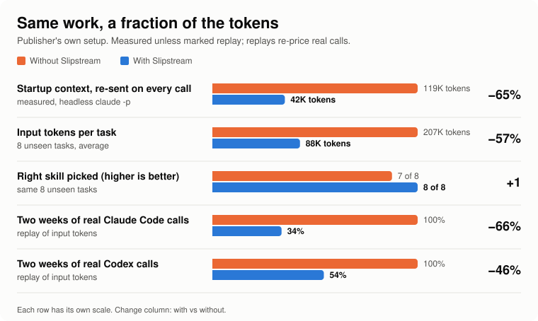
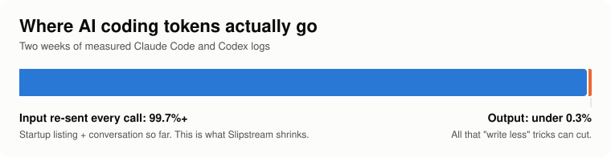

# Slipstream

By **[Lex from SigmaStudioz](https://github.com/sigmastudioz)** · MIT · version 1.0.0.

*S.L.I.P.: Skills Loaded In Precisely. Go further on less fuel.*



Most "save tokens" advice shortens what the model writes. In measured Claude Code and Codex logs,
output was under 0.3% of tokens. Nearly all spend is **context re-sent on every call**: the
startup listing of skills, plugins and tools, plus the conversation so far. Slipstream shrinks
that per-call context while keeping every skill reachable, so work quality does not drop.



## How it differs from typical token savers

| | Typical "save tokens" skill | Slipstream |
| --- | --- | --- |
| What it shrinks | Model output (terse replies) | Input re-sent on every call |
| Share of spend it can touch | Under 0.3% | Over 99.7% |
| Proof | A claim | Measured before/after, a replay on real calls, and a time-split test |
| Skills | Fewer, or all of them always loaded | All still reachable: listing, catalog, prompt-time hints |
| Risk to quality | Unmeasured | Skill choice checked: 8/8 vs 7/8 on unseen tasks |
| Reversible | Varies | Dry run by default; `--undo` restores settings byte for byte |

## What it does

| Lever | Mechanism | Ships as |
| --- | --- | --- |
| Measure | Where input goes: input:output ratio, first-call context, long-session share, polling | `scripts/analyze.py`, `preamble.py`, `skill_usage.py` |
| Smaller startup | List skills used in the last 30 days (plus skills they reference and ones named in global instructions); archive the rest, never delete | `scripts/lean_setup.py` (dry run by default, `--undo`) |
| Nothing lost | A one-line-per-skill catalog of every installed skill (never uninstalled marketplace content); a prompt-time hint names the exact SKILL.md when a request matches; a router skill for manual search | `hooks/slip_hint.py`, `router/`, `scripts/build_catalog.py` |
| New skills safe | A skill installed in the last 30 days always stays listed; installing a skill or plugin rebuilds the catalog at the next session start | `--grace`, `hooks/auto_refresh.py` |
| Self-tuning | Weekly refresh promotes archived skills back into use and relearns the user's own trigger words | `--refresh`, `hooks/auto_refresh.py` |
| Shorter sessions | Silent until a conversation grows ~100K, then suggests a handoff at the next task boundary | `hooks/slip_meter.py` |
| No polling | Denies a bare `sleep N` step; one shell call waits instead of N model calls | `hooks/slip_guard.py`, `scripts/wait_for.sh` |
| Cursor | Cursor keeps no usage locally; parse the account's usage CSV export | `scripts/analyze_cursor_csv.py`, `cursor/slipstream.mdc` |

## Install and use

```text
/plugin install slipstream --marketplace sigmastudioz/agent-skills
```

or `npx skills add sigmastudioz/agent-skills --skill slipstream`. Then ask naturally ("audit my
token usage", "why am I hitting limits?") or:

```text
Use $slipstream to measure where my tokens go and propose a lean setup.
```

The lean setup changes your agent configuration only when you run it with `--apply`:

```sh
python3 skills/slipstream/scripts/lean_setup.py            # dry run: prints the plan
python3 skills/slipstream/scripts/lean_setup.py --apply    # backup + manifest, then apply
python3 skills/slipstream/scripts/lean_setup.py --undo     # exact reversal
```

`--apply` moves unused personal skills to `~/.claude/skill-library/archive/`, builds the catalog,
disables only settings.json plugins that are pure skills/agents/commands with zero recorded use
(never ones shipping hooks, output styles, MCP or LSP), registers four hooks, installs the router
and this skill for Codex, and appends a three-line rule block to `~/.codex/AGENTS.md`. Plugins a
desktop app syncs from an account are reported, not changed.

Requirements: Python 3.9+ (standard library only) and bash for the hooks and `wait_for.sh`.
Nothing is bundled or downloaded: on first use the agent checks for both, tells you what is
missing and the install command for your system, and installs only if you say yes. Windows
needs WSL or Git Bash for the hooks. If you decline, Slipstream runs in guidance-only mode
(its rules, applied by hand) without the measured savings. No network access or accounts.

## Evidence (publisher's own setup)

Measured, not projected, unless marked as a replay:

| Check | Result |
| --- | --- |
| Startup context, headless `claude -p` | 119K → 42K tokens (−65%) with the lean listing |
| Skill choice, 8 unseen tasks for randomly sampled skills | full listing 7/8 · lean 8/8, using 57% fewer input tokens |
| Skill choice, 3 hardest real misses (live) | full 3/3 · lean 3/3, 56% fewer tokens |
| Replay of a month of real skill uses | 95.8% listed, hinted or already in context; the rest mostly bare follow-ups |
| Hint noise on messages that needed no skill | 12%, ~100 tokens per hint |
| Re-orientation cost after a handoff (real sessions) | median 14K, p90 19K tokens |
| Replay: lean startup + handoffs on two weeks of real calls | Claude Code −66%, Codex −46% input |

A rejected mechanism is recorded too: matching skill descriptions for synonyms hinted wrong skills
and raised noise, so it was removed. Replays re-price real calls; they do not prove a future result.

## Limits

- A first-ever request phrased with no words in common with a skill may not get a hint; the
  listing, the router skill and weekly promotion cover it.
- Cache reads are cheaper per token but still count toward plan usage limits.
- Desktop plugins synced from an account must be turned off in that account.
- Cursor's CSV columns are matched by header; check the "columns used" line on your export.

See [data handling](../../PRIVACY.md) for what the helpers read and write.
